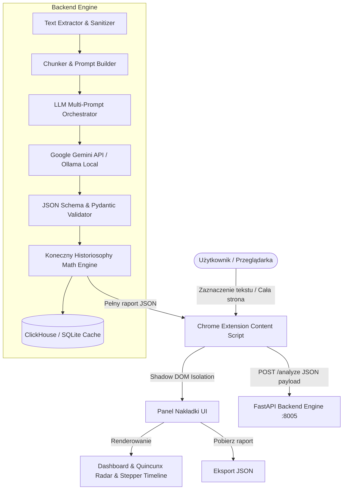
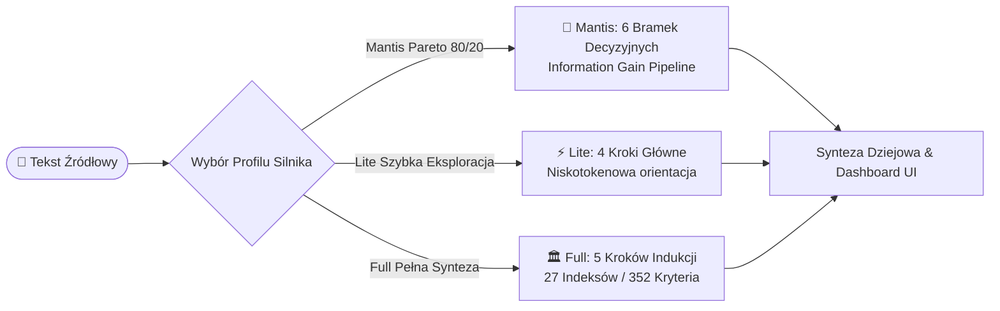
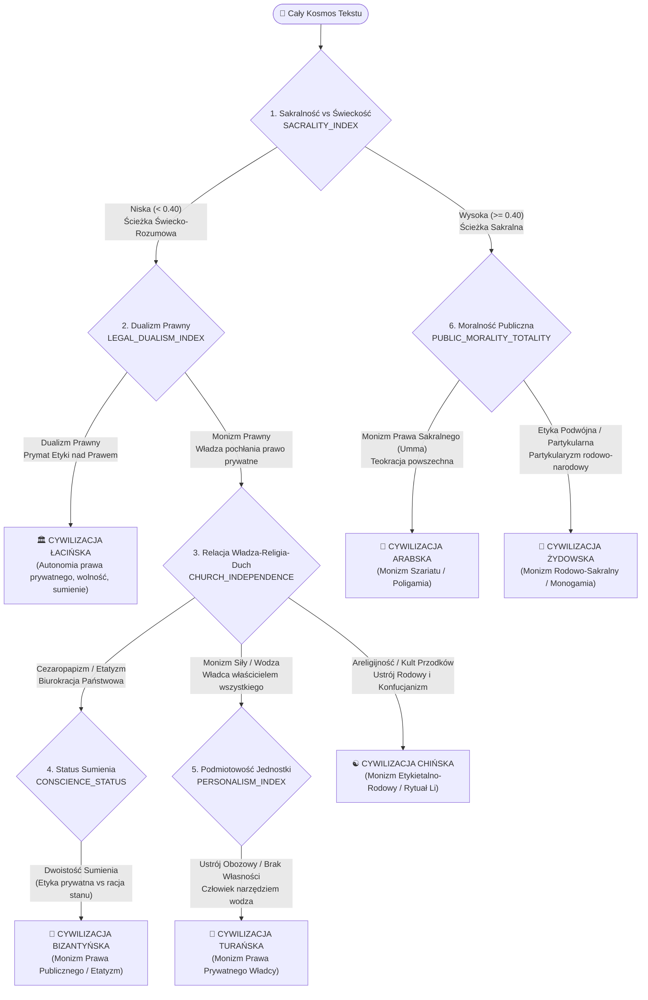
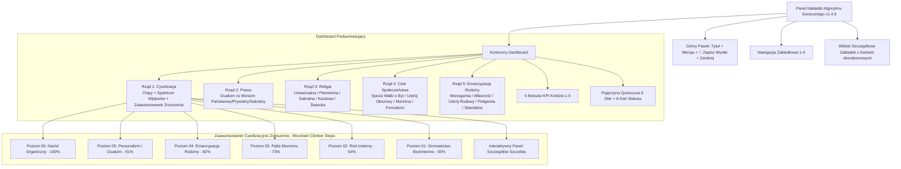

# DESIGN DOCUMENT: ALGORYTM KONECZNEGO
### *Cyfrowe Narzędzie Analizy Historiozoficznej i Komparatystyki Cywilizacyjnej*

---

## 1. Wprowadzenie i Cel Systemu

**Algorytm Konecznego** to zaawansowany system analityczny oparty na metodzie historiozoficznej profesora Feliksa Konecznego (1862–1949). Narzędzie przekształca teoretyczne monografie badacza w indukcję cyfrową: analizuje dowolny tekst źródłowy (artykuły, ustawy, konstytucje, orzeczenia sądowe, manifesty, transkrypcje) i określa jego profil cywilizacyjny, stopień sakralizacji, supremację ducha, spójność etyczną (Siedem Niewiadomych), wydajność historyczną oraz współmierność Pięciomianu Bytu (Quincunx).

---

## 2. Architektura Wysokiego Poziomu (High-Level Architecture)

System składa się z trzech ściśle zintegrowanych warstw:
1. **Warstwa Klienta (Extension / Frontend Overlay)** – Rozszerzenie przeglądarki Chrome działające w izolowanym Shadow DOM, generujące interaktywny dashboard i wizualizacje.
2. **Warstwa Logiki i Serwera (FastAPI Backend Engine)** – Asynchroniczny silnik w Pythonie parsujący tekst, orchestrator zapytań LLM, walidator schematów Pydantic oraz moduł wyliczania metryk Konecznego.
3. **Warstwa Modelu Językowego i Pamięci (LLM & Data Tier)** – Integracja z Gemini API / Ollama / mockami deterministycznymi oraz baza ClickHouse / SQLite dla statystyk i pamiątek dziejowych.



---

## 3. Strumień Przetwarzania Historiozoficznego (Trzy Wersje Silnika i Specyfikacja Kroków)

Przetwarzanie tekstu w silniku analitycznym realizowane jest według założeń naukowej metody Feliksa Konecznego w trzech wyspecjalizowanych profilach wykonawczych: **Mantis** (Pareto 80/20), **Lite** (Szybka Eksploracja) oraz **Full** (Pełna Synteza Historiozoficzna).



---

### Szczegółowa specyfikacja kroków dla 3 wersji silnika:

#### 1. 🦗 Wersja Mantis (Drapieżna Modliszka Decyzyjna — Reguła Pareto 80/20)
*Mantis* to ultra-precyzyjny silnik klasyfikacji o najwyższej efektywności zasobowej. Zamiast analizować wszystkie indeksy naraz, wykorzystuje Zasadę Pareto: **20% kluczowych indeksów rozstrzyga ponad 80% przypadków**, redukując zapytania LLM o ~75% i eliminując ryzyko przekroczenia limitów tokenów/minutę (RPM).

Proces przebiega w sekwencji 6 logicznych bramek decyzyjnych (*Information Gain Decision Gates*):

1. **Bramka 1: `SACRALITY_INDEX` (Sakralność vs Świeckość)**:
   - *Próg rozstrzygnięcia:* `score >= 0.40`.
   - *Ścieżka Sakralna:* Prawo i ustrój są ufundowane na religijnym dogmacie/piśmie świętym (przejście do Bramki 6: cywilizacje Arabska, Żydowska, Bramińska).
   - *Ścieżka Świecko-Rozumowa:* Prawo i moralność są stanowione i interpretowane przez rozum ludzki (przejście do Bramki 2: cywilizacje Łacińska, Bizantyńska, Turańska, Chińska).
2. **Bramka 2: `LEGAL_DUALISM_INDEX` (Dualizm vs Monizm Prawa)**:
   - *Skalpel Cywilizacji Łacińskiej:* Weryfikuje autonomię prawa prywatnego wobec publicznego oraz nadrzędność normy moralnej nad wolą państwa.
   - Jeśli wykryto dualizm prawny (`score >= 0.40`) &rarr; jednoznaczna kwalifikacja: **CYWILIZACJA ŁACIŃSKA**.
   - W razie monizmu prawnego (państwo pochłania sferę prywatną) &rarr; przejście do Bramki 3.
3. **Bramka 3: `CHURCH_INDEPENDENCE_INDEX` (Niezależność Kościoła / Relacja Władza-Religia-Duch)**:
   - *Cezaropapizm / Etatyzm:* Władza państwowa podporządkowuje sobie hierarchię kościelną i czyni z religii narzędzie administracji &rarr; przejście do Bramki 4 (Bizancjum).
   - *Monizm Siły / Wodza:* Władca jest właścicielem całego terytorium i ludności, brak stabilnego prawa prywatnego &rarr; przejście do Bramki 5 (Turan).
   - *Areligijność / Kult Przodków:* Ustrój rodowy (klanowy), konfucjański rytuał *Li* i etykieta zastępująca prawo &rarr; **CYWILIZACJA CHIŃSKA**.
4. **Bramka 4: `CONSCIENCE_STATUS_INDEX` (Status Sumienia — Dwoistość vs Jedność)**:
   - Wykrywa rozdwojenie etyki: sumienie obowiązuje w życiu prywatnym, lecz zostaje zawieszone w działalności państwowej na rzecz „racji stanu” i statolatrii &rarr; **CYWILIZACJA BIZANTYŃSKA**.
5. **Bramka 5: `PERSONALISM_INDEX` (Podmiotowość Jednostki vs Ustrój Obozowy)**:
   - Wykrywa redukcję człowieka do roli żołnierza/narzędzia w rękach wodza, ustrój obozowy oraz brak stabilnej własności ziemskiej &rarr; **CYWILIZACJA TURAŃSKA**.
6. **Bramka 6: `PUBLIC_MORALITY_TOTALITY_INDEX` (Uniwersalizm vs Partykularyzm na Ścieżce Sakralnej)**:
   - *Powszechny Monizm Sakralny (Umma):* Prawo religijne obowiązuje jednakowo każdego wiernego, teokracja uniwersalna (Szariat) &rarr; **CYWILIZACJA ARABSKA**.
   - *Etyka Podwójna / Partykularna:* Inne normy etyczne wobec członków własnego rodu/narodu wybranego, inne wobec obcych (Halacha) &rarr; **CYWILIZACJA ŻYDOWSKA**.



---

#### 2. ⚡ Wersja Lite (Szybka Eksploracja 4-Krokowa)
Tryb dedykowany natychmiastowej orientacji w profilu tekstu. Łączy analizę 4 kluczowych zagadnień w zaledwie 3–4 promptach LLM:

1. **Krok 1: Weryfikacja Sakralności (`sacrality`)** – weryfikuje uświęcenie instytucji państwowych i prymat norm religijnych.
2. **Krok 2: Czterofilary Supremacji Ducha (`dualism`, `aposteriori`, `family`, `church`)** – bada obecność dualizmu prawnego, empiryzmu prawnego, suwerenności rodziny i niezależności Kościoła.
3. **Krok 3: Spójność Etyczna 7 Generaliów (`generalia`)** – oblicza zagregowaną spójność etyczną (`ethical_coherence_score` w skali 0.0 - 7.0).
4. **Krok 4: Zwięzły Quincunx (`quincunx`)** – orientacyjna weryfikacja obecności i harmonii 5 sfer bytu.

---

#### 3. 🏛️ Wersja Full (Pełna Synteza Historiozoficzna — 5 Kroków Indukcji, 27 Indeksów, 352 Kryteria)
Kompletne cyfrowe odwzorowanie całokształtu dorobku Feliksa Konecznego. Obejmuje 5 kolejnych kroków indukcyjnych:


1. **Krok 1: Indeks Sakralności (`SACRALITY_INDEX` - 13 wskaźników szczegółowych)**:
   - Mierzy stopień uświęcenia prawa i państwa, hierarchię prawa religijnego wobec stanowionego, dogmatyzm kazuistyczny oraz odrzucenie statolatrii i cezaropapizmu.
2. **Krok 2: Supremacja Ducha (Agregacja 12 pod-indeksów ustrojowych)**:
   - Mierzy przewagę sił duchowych nad fizyczną przymusowością w 12 obszarach ustrojowych:
     - **Dualizm Prawny** (`LEGAL_DUALISM_INDEX`)
     - **Pluralizm Źródeł Prawa** (`LAW_SOURCE_PLURALISM_INDEX`)
     - **Prawo Aposterioryczne vs Apriori** (`APOSTERIORI_APRIORI_INDEX`)
     - **Organizm vs Mechanizm Społeczny** (`ORGANISM_MECHANISM_INDEX`)
     - **Personalizm** (`PERSONALISM_INDEX`)
     - **Autonomia i Emancypacja Rodziny** (`FAMILY_LAW_AUTONOMY_INDEX`)
     - **Niezależność Kościoła** (`CHURCH_INDEPENDENCE_INDEX`)
     - **Stabilność Własności Prywatnej** (`PROPERTY_RIGHTS_STABILITY_INDEX`)
     - **Ciągłość Dziedziczenia** (`INHERITANCE_CONTINUITY_INDEX`)
     - **Supremacja Moralności** (`MORALITY_SUPREMACY_INDEX`)
     - **Totalność Moralności Publicznej** (`PUBLIC_MORALITY_TOTALITY_INDEX`)
     - **Odpowiedzialność Urzędnicza** (`ADMINISTRATIVE_RESPONSIBILITY_INDEX`)
3. **Krok 3: Szereg Personalistyczny (Generalia Etyki — 7 Niewiadomych)**:
   - Wylicza wskaźnik spójności etycznej (`ethical_coherence_score` 0.0 - 7.0) oraz diagnozuje **Szereg Personalistyczny** (Cywilizacja Łacińska) vs **Szereg Gromadnościowy** vs **Mieszankę Trującą** (stan acywilizacyjny).
   - Obejmuje 7 pod-indeksów etycznych:
     - **Personalistyczne Źródło Obowiązku** (`duty_source` - 13 wskaźników)
     - **Motywacja i Bezinteresowność** (`motivation` - 14 wskaźników)
     - **Natura Sprawiedliwości** (`justice_nature` - 16 wskaźników)
     - **Status Sumienia: Autonomia vs Heteronomia** (`conscience_status` - 15 wskaźników)
     - **Opanowanie Czasu i Historyzm** (`time_mastery` - 15 wskaźników)
     - **Ethos Pracy i Uświęcenie** (`work_ethos` - 14 wskaźników)
     - **Odpowiedzialność Osobista**
4. **Krok 4: Chyżość Historyczna (Wydajność Cywilizacyjna)**:
   - Mierzy zdolność zrzeszenia do **kapitalizowania i oszczędzania czasu** dla przyszłych pokoleń, akumulacji dorobku dziejowego oraz uniknięcia powracania do stanu pierwotnego *ab ovo*.
5. **Krok 5: Współmierność Pięciomianu Bytu (Quincunx - 5 Sfer Bytu)**:
   - Matematyczna weryfikacja harmonijnej spójności 5 sfer bytu (Dobro, Prawda, Zdrowie, Dobrobyt, Piękno) wyliczana za pomocą średniej geometrycznej $\sqrt[5]{D \cdot P \cdot Z \cdot Db \cdot Pi}$, mnożnika spójności $Consistency\_Factor$ oraz kary za zwichnięcie hegemonii etyki ($Hegemony\_Penalty$).

---

## 4. Architektura UI Dashboardu i Modułów Wizualnych

Dashboard w nakładce Chrome (`extension/content.js`) jest podzielony na ergonomiczne sekcje informacyjne:



---

## 5. Matryca Klasyfikacji Cywilizacji i Ustrojów

Poniższa tabela przedstawia zasady indukcyjnej kategoryzacji tekstu przez algorytm:

| Cywilizacja | Supremacja Ducha | Sakralność | Prawo | Religia | Rodzina i Majątek | Czas i Praca |
| :--- | :---: | :---: | :--- | :--- | :--- | :--- |
| **Łacińska** | **Wysoka (>50%)** | **Niska (<30%)** | **Dualizm Prawny** (prywatne + publiczne) | Uniwersalna etyczna (autonomia sumienia) | Monogamia dożywotnia, pełna emancypacja, własność prywatna | Czas linearny, praca wolna i celowa |
| **Bizantyńska** | Niska (<45%) | Niska | **Monizm Prawa Publicznego** (państwowy) | Państwowa / Podporządkowana | Rodzina zdominowana przez biurokrację i etatyzm | Czas mechaniczny, praca regulowana ustawą |
| **Turańska** | Bardzo niska (<30%) | Niska | **Monizm Prawa Prywatnego** (władcy) | Areligijność / Formalizm | Rodzina w ustroju obozowym, brak stabilnej własności | Czas doraźny, praca przymusowa / wojenny podbój |
| **Arabska** | Średnia/Niska | **Bardzo wysoka (>60%)** | **Monizm Sakralny** (Szariat/Teokracja) | Państwowa / Sakralna | Poligamia dopuszczalna, brak pełnej emancypacji majątkowej | Fatalizm dziejowy, rytuał ponad pragmatykę |
| **Żydowska** | Specyficzna | **Wysoka (>50%)** | **Monizm Prawno-Sakralny** | Narodowa / Prawotwórcza | Silna tradycja rodowa, kazuistyka prawna | Czas mesjanistyczny, ścisły legalizm |
| **Bramińska** | Niska | Wysoka | **Monizm Kastowo-Rytualny** | Monolatria / Kastowa | Podział kastowy, ustrój rodowo-wielorodzinny | Reinkarnacja, bierność dziejowa |
| **Chińska** | Niska | Niska | **Monizm Etykietowo-Rodowy** | Areligijna (kult przodków) | Ustrój rodowy (klanowy), brak niezależności syna za życia ojca | Czas cykliczny, brak dogmatów |

---

## 6. Model Danych Wyjściowych (JSON Schema Export) i Odwzorowanie w Dashboardzie UI

Przycisk **`💾 Zapisz wyniki`** w nagłówku wtyczki (`extension/content.js`) generuje i pobiera pełny plik raportu JSON. Struktura eksportu odzwierciedla całościowy stan analityczny i wizualny dashboardu:

### 6.1. Pełna Struktura Pliku JSON (Export Payload)

```json
{
  "meta": {
    "aplikacja": "Algorytm Konecznego - Analiza Cywilizacyjna",
    "metoda": "Historiozoficzna metoda Feliksa Konecznego",
    "wersja": "1.4.6",
    "data_analizy": "2026-10-18T19:45:00.000Z",
    "url": "https://pl.wikipedia.org/wiki/Rzeczpospolita",
    "tytuł_strony": "Rzeczpospolita Obojga Narodów"
  },
  "klasyfikacja_dashboard": {
    "cywilizacja_główna": "Łacińska",
    "diagnoza_cywilizacyjna": "Dominacja norm personalistycznych i dualizm prawny",
    "sakralność": 0.08,
    "supremacja_ducha": 0.88,
    "etyka_7_generaliów": 6.8,
    "diagnoza_generaliów": "SZEREG PERSONALISTYCZNY (Cywilizacja Łacińska)",
    "chyżość_historyczna_oponowanie_czasu": 0.85,
    "quincunx_pięciomian_bytu": 0.92,
    "diagnoza_quincunxa": "PEŁNIA CYWILIZACJI ŁACIŃSKIEJ (Harmonia 5/5 sfer Pięciomianu pod przodownictwem Etyki)"
  },
  "kategorie_pięciomianu_quincunx": {
    "dobro": 0.95,
    "prawda": 0.92,
    "zdrowie": 0.84,
    "dobrobyt": 0.88,
    "piekno": 0.82
  },
  "surowe_oceny_indeksów": {
    "sacrality_scores": {
      "theocratic_authority": { "score": 0.05, "rationale": "Władza oparta na elekcji i prawie ziemskim" },
      "sacral_monism": { "score": 0.10, "rationale": "Rozdział sfery sacrum i profanum" }
    },
    "spirit_scores": {
      "legal_dualism": { "score": 0.95, "rationale": "Neminem captivabimus nisi iure victum" }
    },
    "generalia_scores": {
      "duty_source": { "score": 1.0 },
      "motivation": { "score": 0.95 }
    },
    "quincunx_scores": {
      "good_above_force": { "score": 0.95 },
      "natural_truth": { "score": 0.90 }
    }
  },
  "pełne_dane_wynikowe": {
    "mode": "mantis",
    "primary_civilization": "Łacińska",
    "civilization_diagnosis": "Dominacja norm personalistycznych i dualizm prawny",
    "mantis_gates": [
      {
        "gate": 1,
        "name": "Bramka 1: Sakralność vs Świeckość (SACRALITY_INDEX)",
        "score": 0.08,
        "decision": "Ścieżka Świecko-Rozumowa (Łacińska / Bizantyńska / Turańska)"
      },
      {
        "gate": 2,
        "name": "Bramka 2: Dualizm vs Monizm Prawa (LEGAL_DUALISM_INDEX)",
        "score": 0.92,
        "decision": "Dualizm Prawny -> Cywilizacja Łacińska (Prymat etyki i prawa prywatnego)"
      }
    ],
    "sacrality_score": 0.08,
    "spirit_supremacy_score": 0.88,
    "legal_dualism_score": 0.92,
    "law_source_pluralism_score": 0.85,
    "aposteriori_apriori_score": 0.82,
    "organism_mechanism_score": 0.90,
    "personalism_score": 0.94,
    "family_law_autonomy_score": 0.86,
    "church_independence_score": 0.89,
    "property_rights_stability_score": 0.88,
    "inheritance_continuity_score": 0.84,
    "morality_supremacy_score": 0.91,
    "public_morality_totality_score": 0.87,
    "administrative_responsibility_score": 0.80,
    "duty_source_personalistic_score": 0.92,
    "motivation_altruism_score": 0.89,
    "justice_equity_score": 0.95,
    "conscience_autonomous_score": 0.93,
    "time_mastery_history_score": 0.85,
    "work_ethos_sanctification_score": 0.88,
    "ethical_coherence_score": 6.8,
    "quincunx_coherence_score": 0.92,
    "history_stats": {
      "total_runs": 3,
      "avg_quincunx": 0.90
    }
  }
}
```

### 6.2. Odwzorowanie Modelu Danych w Komponentach Dashboardu UI

Dane zawarte w obiekcie eksportu zasilają poszczególne panele wizualne nakładki wtyczki:

1. **Główny Banner Wyniku i Kwalifikacji**:
   - `cywilizacja_główna` oraz `diagnoza_cywilizacyjna` determinują motyw kolorystyczny, ikonę zrzeszenia oraz główny nagłówek raportu.
2. **Pasek Spektrum Cywilizacyjnego**:
   - Wylicza procentowy udział wpływów 7 cywilizacji w badanym tekście (np. 88% Łacińska, 8% Bizantyńska, 4% Żydowska) na podstawie wag pod-indeksów.
3. **Drabina Zaawansowania Cywilizacyjnego Zrzeszenia (Poziomy 01–06)**:
   - Wizualizuje ewolucję społeczną od bezimiennej gromady po personalizm i naród:
     - **Poziom 01: Gromadztwo** – brak nazwisk, brak prawa do dziedziczenia, kolektyw bezimienny.
     - **Poziom 02: Ród Imienny** – ukształtowanie tożsamości rodowej, kult przodków.
     - **Poziom 03: Pętla Monizmu / Cezaryzmu** – próba wchłonięcia rodu przez machinę państwową / władcę.
     - **Poziom 04: Emancypacja Rodziny** – indywidualna własność majątkowa, monogamia dożywotnia.
     - **Poziom 05: Personalizm** – emancypacja osoby ludzkiej, prymat sumienia, dualizm prawny.
     - **Poziom 06: Naród** – dobrowolne zrzeszenie nadrzędne złączone wspólnym etosem i kulturą duchową.
4. **Matryca Czwórmianu Ustrojowego**:
   - **Prawo:** `Dualizm Prawny` (aktywny przy prymacie prawa prywatnego) vs `Monizm Prawa Publicznego` (państwowy) vs `Monizm Prawa Prywatnego` (władcy) vs `Monizm Sakralny`.
   - **Religia:** `Uniwersalna (Etyczna)` vs `Plemienna / Narodowa` vs `Państwowa / Sakralna` vs `Kastowa` vs `Areligijność / Świeckość`.
   - **Cele Społeczeństwa:** `Spoza Walki o Byt (Naród & Osoba)` vs `Walka o Byt (Ustrój Obozowy)` vs `Machina Państwowa (Biurokracja)` vs `Formalizm / Rytuał` vs `Kultywowanie Rodu`.
   - **Emancypacja Rodziny:** `Pełna Emancypacja (Monogamia i Własność Indywidualna)` vs `Klany Rodowe` vs `Poligamia / Brak Emancypacji` vs `Statolatria / Kolektywizm`.
5. **Karty Kroku 1 do 5 (Wskaźniki Szczegółowe)**:
   - Wyświetlają kafelki metryczne: Sakralność (`sakralność`), Supremacja Ducha (`supremacja_ducha`), Generalia Etyki (`etyka_7_generaliów`), Chyżość Historyczna (`chyżość_historyczna_oponowanie_czasu`) oraz Quincunx (`quincunx_pięciomian_bytu`).
6. **Pajęczyna Quincunxa (Wykres Radarowy SVG)**:
   - Dynamiczny pięciokąt rozpięty na osiach: Dobro, Prawda, Zdrowie, Dobrobyt, Piękno, obrazujący harmonię Pięciomianu Bytu.

---

## 7. Testy i Walidacja Jakościowa

Projekt utrzymuje 100% pokrycia kluczowych scenariuszy historycznych testami jednostkowymi (`pytest tests/unit`):
- `test_poland_wikipedia_scenario`: Weryfikacja cywilizacji łacińskiej, wysokiej supremacji ducha i dualizmu prawnego dla tradycji Rzeczypospolitej.
- `test_taliban_wikipedia_scenario`: Weryfikacja monizmu sakralnego i cywilizacji arabsko-sakralnej dla teokracji szariatu.
- `test_prl_scenario`: Weryfikacja przypisania totalitarnego państwa komunistycznego do cywilizacji bizantyńsko-turańskiej i monizmu państwowego (zamiast łacińskiej).
- `test_france_2026_laicite_scenario`: Weryfikacja ustroju laickiego i rozdzielności prawa świeckiego.
- `test_polona_digital_library_scenario`: Test ekstrakcji i analizy druków ulotkowych i zdigitalizowanych zasobów dziedzictwa.
