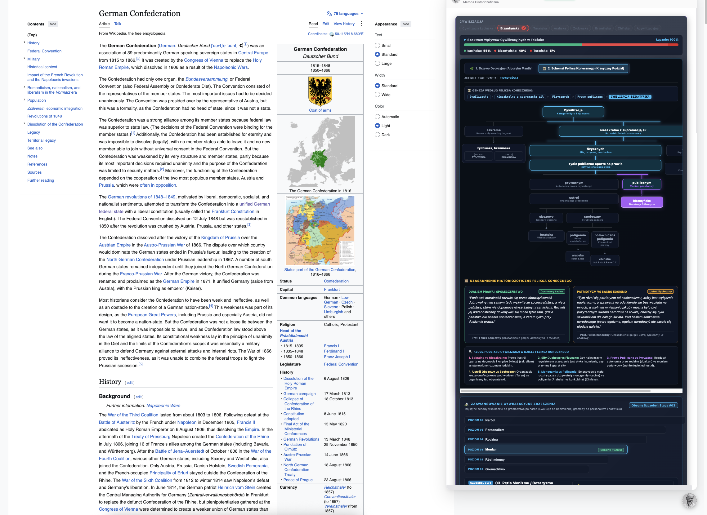

# Algorytm Konecznego

Teoria cywilizacji Feliksa Konecznego w formie aplikacji i wtyczki do przeglądarki.





<details>
<summary><b>Szybki start (Instalacja i uruchomienie)</b></summary>

### 1. Backend
```bash
git clone https://github.com/Pawel-Zygler/algorytm_konecznego.git
cd algorytm_konecznego
pip install -r backend/requirements.txt
cp backend/.env.template backend/.env  # wpisz GEMINI_API_KEY z Google AI Studio
make start                            # serwer: http://127.0.0.1:8005 (stop: make stop)
```

### 2. Wtyczka Chrome / Edge
1. Otwórz `chrome://extensions/` i włącz **Tryb dewelopera**.
2. Kliknij **Załaduj rozpakowane** i wskaż folder `extension/`.
3. Kliknij ikonę wtyczki, wpisz klucz API i zapisz.
4. Kliknij portret profesora w rogu strony, aby zbadać tekst.

</details>

<details>
<summary><b>5 Kroków Historiozoficznych (Indeksy)</b></summary>

1. **Sakralność:** sacrum vs profanum (świeckość a teokracja).
2. **Supremacja Ducha:** prymat etyki, dualizm prawny, wolność rodziny i własności.
3. **Generalia Etyki:** 7 kategorii moralnych (Szereg Personalistyczny).
4. **Chyżość Historyczna:** zdolność akumulacji dorobku pokoleń.
5. **Quincunx (Pięciomian Bytu):** współmierność sfer: Dobro, Prawda, Zdrowie, Dobrobyt, Piękno.

</details>

<details>
<summary><b>Tryby Silnika: Mantis, Lite i Full</b></summary>

### 1. 🦗 Mantis AI (Reguła Pareto 80/20)
Szybka klasyfikacja przez 6 sekwencyjnych bramek decyzyjnych:


- **Sakralność:** cywilizacje sakralne vs świecko-rozumowe.
- **Dualizm prawny:** prymat etyki i autonomia prawa prywatnego (Łacina).
- **Niezależność Kościoła:** etatyzm vs siła vs kult rodu vs wolność sumienia.
- **Status sumienia:** jedność etyczna vs podwójna moralność.
- **Personalizm:** wolna osoba vs narzędzie władzy.
- **Moralność publiczna:** monizm sakralny vs etyka rodowa.

---

### 2. ⚡ Lite Scan
Szybki skan (1-3 prompty) kluczowych indeksów dający wstępny profil w parę sekund.

---

### 3. ✨ Full Kosmos
Pełna synteza: 27 indeksów, 352 pytania, radar Quincunxa i Szereg Personalistyczny.

</details>

<details>
<summary><b>Testy automatyczne (Playwright E2E & Unit)</b></summary>

Automatyzacja w TypeScript (`e2e/`) zintegrowana z CI/CD:
- **Powtarzalność:** czyste profile tymczasowe bez blokad.
- **Wznawianie:** `make test-resume` (wznawia tylko nieudane testy).
- **Diagnostyka:** logi ze znacznikami czasu, zrzuty ekranu, HTML Shadow DOM i trace.
- **Polecenia:**
  - `make test-smoke` – szybki test wtyczki (domyślny)
  - `make test-logs` – uruchomienie z logami zdarzeń na żywo
  - `make test-resume` – wznowienie od błędu (`--last-failed`)
  - `make test-repeat` – 3 cykle powtórzeń (stabilność)
  - `make test-ui` – interfejs graficzny Playwright
  - `make test-trace` – generowanie `trace.zip`
  - `make test-report` – raport HTML
  - `make test-all` – testy jednostkowe + E2E

Szczegóły: [e2e/README.md](e2e/README.md).

</details>