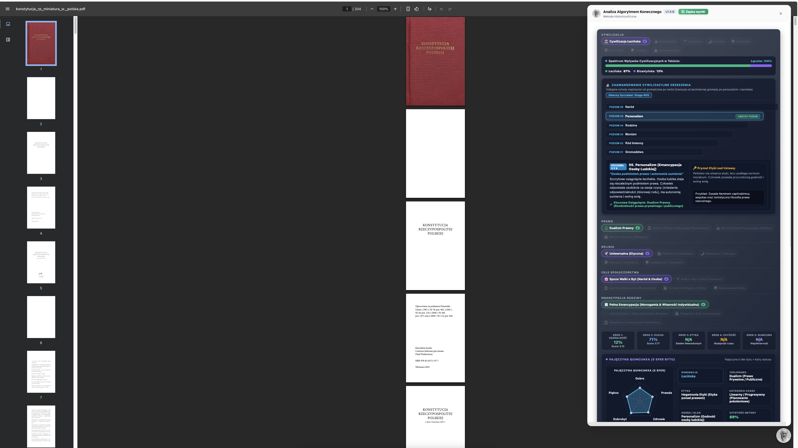
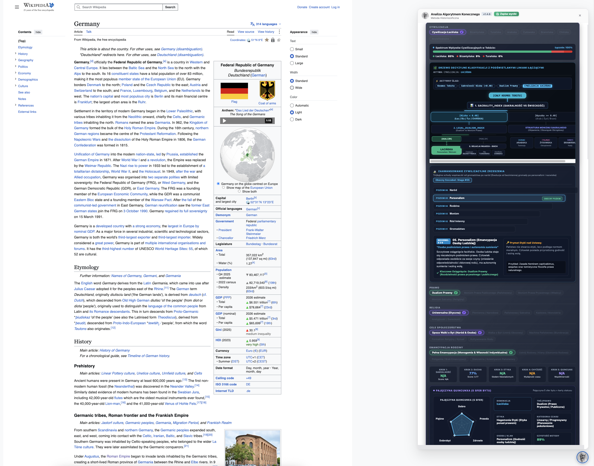
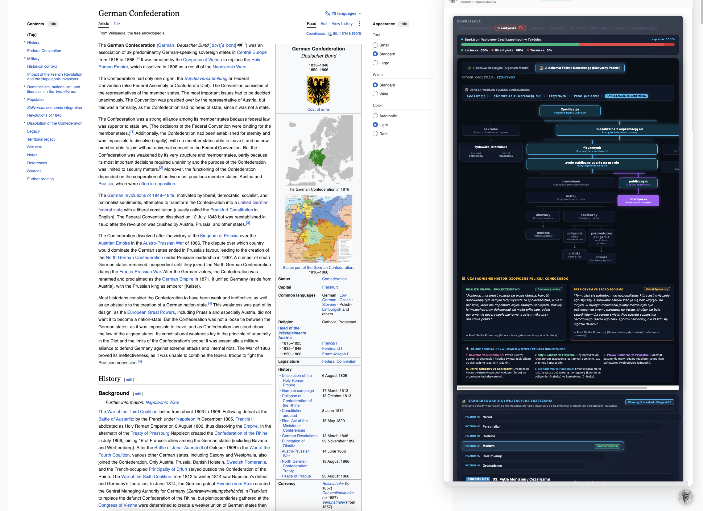
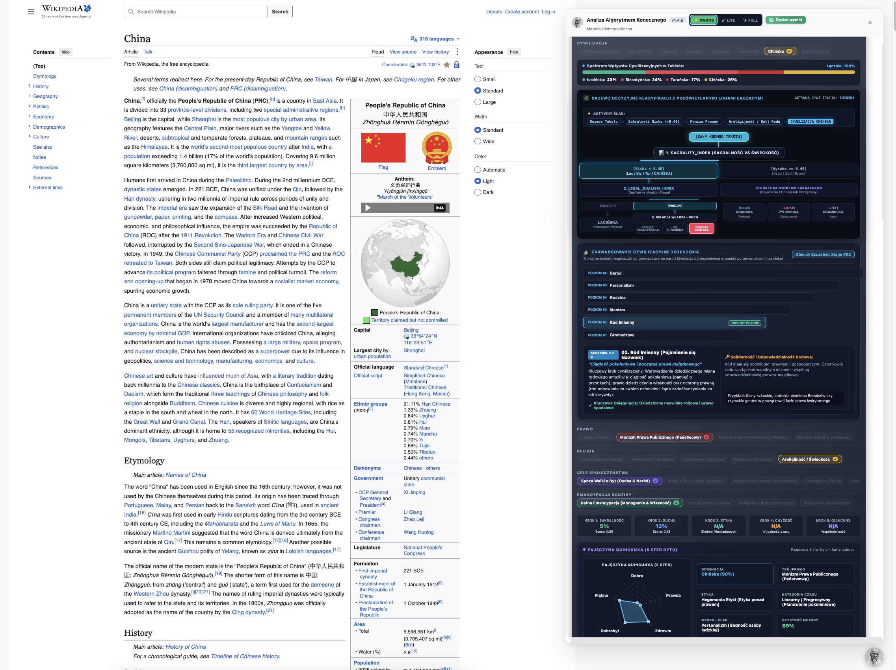
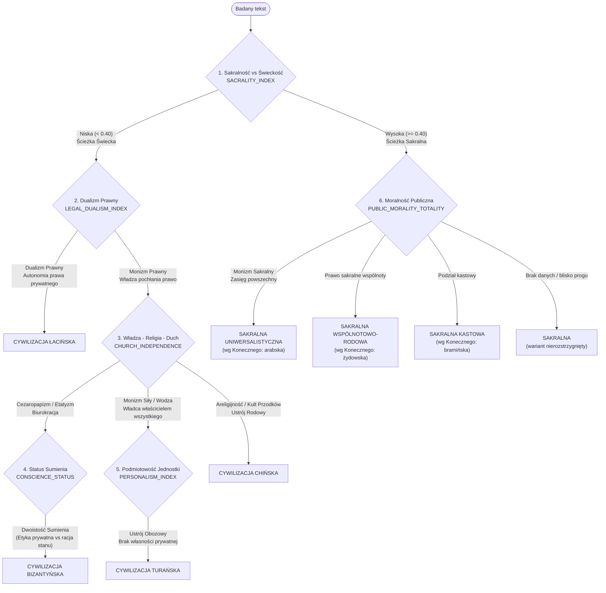

# Algorytm Konecznego

> **Nota metodologiczna:** Narzędzie badawczo-edukacyjne oparte na historyczno-filozoficznej metodzie porównawczej prof. Feliksa Konecznego (1862–1949).

Teoria cywilizacji Feliksa Konecznego w formie aplikacji i wtyczki do przeglądarki.






## Szybki start (4 proste kroki)

Wtyczka działa bezpośrednio w przeglądarce (Direct Chrome Mode) i łączy się z modelem Gemini — nie musisz nawet uruchamiać lokalnego backendu w Pythonie!

### 1. Stwórz konto na Google AI i pobierz darmowy klucz API
1. Wejdź na stronę [Google AI Studio](https://aistudio.google.com/app/apikey).
2. Zaloguj się swoim zwykłym kontem Google (Gmail). Jeśli wchodzisz pierwszy raz, zaakceptuj regulamin.
3. Kliknij niebieski przycisk **Create API key** (Utwórz klucz API).
4. Skopiuj wygenerowany ciąg znaków (to Twój klucz API — zachowaj go, wkleisz go w kroku 3). *(Klucz jest bezpłatny i służy do łączenia się ze sztuczną inteligencją Gemini).*

### 2. Zainstaluj wtyczkę w Chrome / Edge / Brave
1. Otwórz stronę `chrome://extensions/` w przeglądarce.
2. Włącz suwak **Tryb dewelopera** (w prawym górnym rogu).
3. Kliknij przycisk **Załaduj rozpakowane** (Load unpacked) i wskaż katalog `extension/` z tego repozytorium.

### 3. Wklej klucz API w opcjach wtyczki
1. Kliknij ikonę wtyczki **Koneczny Civilization Analyzer** na pasku rozszerzeń przeglądarki (obok paska adresu).
2. Wklej swój klucz w polu **Klucz Gemini API** i kliknij **Zapisz konfigurację**. *(Domyślny tryb to Direct Chrome Mode — gotowe do użycia!)*

### 4. Znajdź tekst i kliknij głowę profesora
1. Otwórz dowolny artykuł lub stronę w przeglądarce, np. w Wikipedii:
   - [Law of Russia](https://en.wikipedia.org/wiki/Law_of_Russia)
   - [Polska](https://pl.wikipedia.org/wiki/Polska)
   - [German Confederation](https://en.wikipedia.org/wiki/German_Confederation)
   - lub dowolny dokument PDF
2. Kliknij pływający **portret prof. Feliksa Konecznego** w prawym dolnym rogu strony.
3. Panel boczny przeprowadzi analizę metodą historiozoficzną i wyświetli dashboard cywilizacyjny po około 1m.

<details>
<summary><b>Quick Start Guide (English)</b></summary>

### Quick Start (4 simple steps)

The extension runs directly in your browser (Direct Chrome Mode) and connects to the Gemini model — no need to run a local Python backend!

#### 1. Create a Google AI account and get a free API key
1. Go to [Google AI Studio](https://aistudio.google.com/app/apikey).
2. Sign in with your standard Google account (Gmail). If it's your first time, accept the terms of service.
3. Click the blue **Create API key** button.
4. Copy the generated key string (keep it handy — you will paste it in Step 3). *(The key is completely free and used to communicate with Gemini AI).*

#### 2. Install the extension in Chrome / Edge / Brave
1. Navigate to `chrome://extensions/` in your browser.
2. Enable the **Developer mode** toggle in the top-right corner.
3. Click **Load unpacked** and select the `extension/` directory from this repository.

#### 3. Paste the API key into the extension options
1. Click the **Koneczny Civilization Analyzer** icon in your browser toolbar (next to the address bar).
2. Paste your API key into the **Gemini API Key** field and click **Save Configuration**. *(Default mode is Direct Chrome Mode — ready to go!)*

#### 4. Find any text and click the Professor's portrait
1. Open any article or page in your browser, for example on Wikipedia:
   - [Law of Russia](https://en.wikipedia.org/wiki/Law_of_Russia)
   - [Polska](https://pl.wikipedia.org/wiki/Polska)
   - [German Confederation](https://en.wikipedia.org/wiki/German_Confederation)
   - or any PDF document
2. Click the floating **portrait of Prof. Feliks Koneczny** in the bottom-right corner of the page.
3. The side panel will run the historiosophical analysis and present the civilizational dashboard in about 1 minute.

</details>

---

<details>
<summary><b>Opcjonalnie: Uruchomienie z lokalnym backendem (Python / FastAPI)</b></summary>

Jeśli wolisz korzystać z lokalnego serwera backendowego:
```bash
1. git clone https://github.com/Pawel-Zygler/algorytm_konecznego.git
2. cd algorytm_konecznego
3. pip install -r backend/requirements.txt
4. cp backend/.env.template backend/.env  # wpisz GEMINI_API_KEY z Google AI Studio
5. make start                            # serwer: http://127.0.0.1:8005 (stop: make stop)
```
W popupie wtyczki przełącz tryb na **Lokalny Backend (Python)**.

</details>

<details>
<summary><b>5 Kroków Historiozoficznych (Indeksy)</b></summary>

1. **Sakralność:** sacrum vs profanum (świeckość a teokracja).
2. **Supremacja Ducha:** prymat etyki, dualizm prawny, wolność rodziny i własności.
3. **Generalia Etyki:** 7 kategorii moralnych (Szereg Personalistyczny).
4. **Chyżość Historyczna:** zdolność akumulacji dorobku pokoleń.
5. **Quincunx (Pięciomian Bytu):** współmierność sfer: Dobro, Prawda, Zdrowie, Dobrobyt, Piękno.

</details>

<details>
<summary><b>Tryby Silnika: Mantis, Lite i Full</b></summary>

### 1. Mantis AI (Reguła Pareto 80/20)
Szybka klasyfikacja przez 6 sekwencyjnych bramek decyzyjnych:



- **Sakralność:** cywilizacje sakralne vs świecko-rozumowe.
- **Dualizm prawny:** prymat etyki i autonomia prawa prywatnego (Łacina).
- **Niezależność Kościoła:** etatyzm vs siła vs kult rodu vs wolność sumienia.
- **Status sumienia:** jedność etyczna vs podwójna moralność.
- **Personalizm:** wolna osoba vs narzędzie władzy.
- **Moralność publiczna:** wariant ustroju sakralnego (uniwersalistyczny, wspólnotowo-rodowy, kastowy). Przy braku danych lub wynikach blisko progu wariant jest nierozstrzygnięty.

> Nazwy cywilizacji to terminy teorii Konecznego (lata 30. XX w.) opisujące typy ustroju prawnego. Nie opisują współczesnych narodów ani wyznawców religii, a niski wynik na skali oznacza inny model, nie gorszy.

---

### 2. Lite Scan
Szybki skan (1-3 prompty) kluczowych indeksów dający wstępny profil w parę sekund.

---

### 3. Full Kosmos
Pełna synteza: 27 indeksów, 352 pytania, radar Quincunxa i Szereg Personalistyczny.

</details>

<details>
<summary><b>Testy automatyczne (Playwright E2E & Unit)</b></summary>

Automatyzacja w TypeScript (`e2e/`) zintegrowana z CI/CD:
- **Powtarzalność:** czyste profile tymczasowe bez blokad.
- **Wznawianie:** `make test-resume` (wznawia tylko nieudane testy).
- **Diagnostyka:** logi ze znacznikami czasu, zrzuty ekranu, HTML Shadow DOM i trace.
- **Polecenia:**
  - `make test-smoke` – szybki test wtyczki (domyślny)
  - `make test-logs` – uruchomienie z logami zdarzeń na żywo
  - `make test-resume` – wznowienie od błędu (`--last-failed`)
  - `make test-repeat` – 3 cykle powtórzeń (stabilność)
  - `make test-ui` – interfejs graficzny Playwright
  - `make test-trace` – generowanie `trace.zip`
  - `make test-report` – raport HTML
  - `make test-all` – testy jednostkowe + E2E

Szczegóły: [e2e/README.md](e2e/README.md) oraz specyfikacja scenariuszy ISTQB w [docs/TEST_SCENARIOS.md](docs/TEST_SCENARIOS.md).

</details>