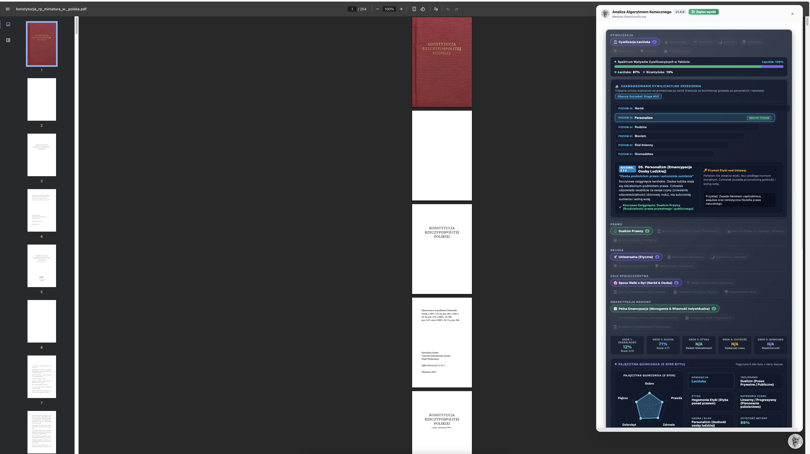
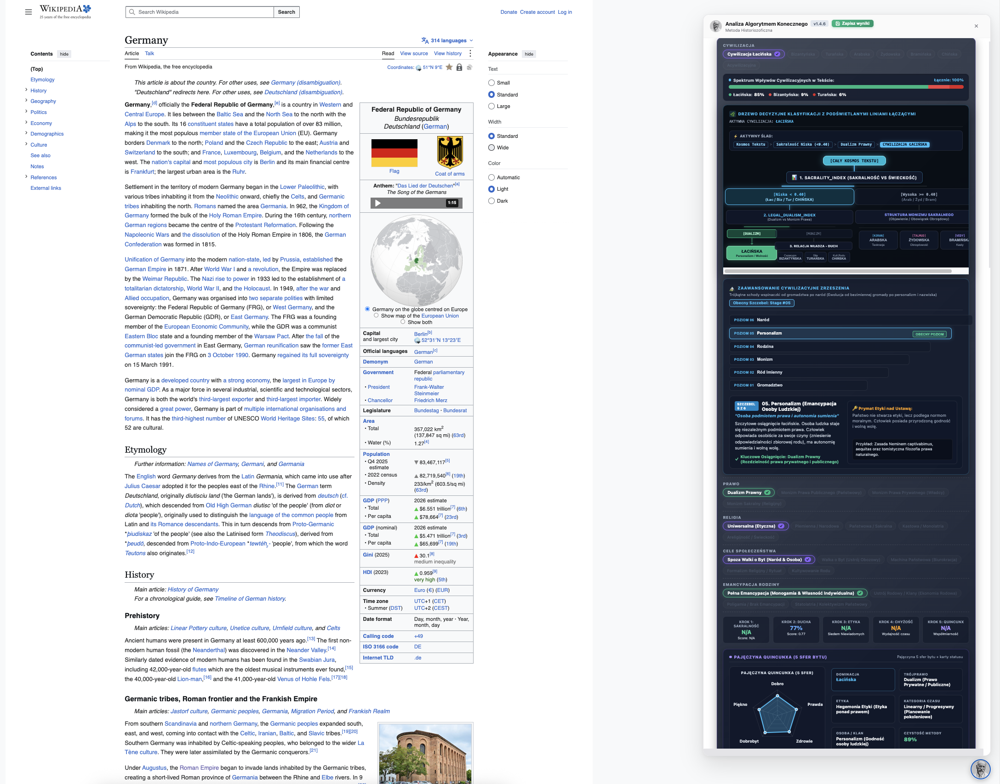
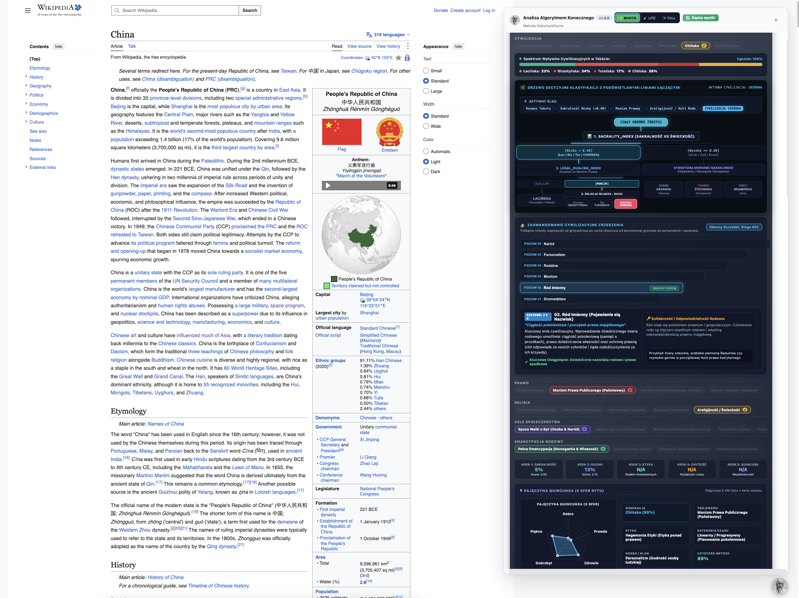
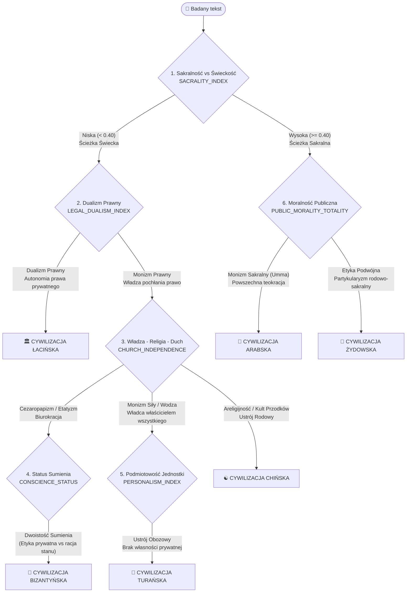

# Algorytm Konecznego

Teoria podziału na cywilizacje Feliksa Konecznego w formie cyfrowej aplikacji i wtyczki do przeglądarki.





<details>
<summary><b>Szybki start (Instalacja i uruchomienie)</b></summary>

### 1. Backend
```bash
git clone https://github.com/Pawel-Zygler/algorytm_konecznego.git
cd algorytm_konecznego
pip install -r backend/requirements.txt
cp backend/.env.template backend/.env  # wpisz GEMINI_API_KEY
make start                            # serwer: http://127.0.0.1:8005 (stop: make stop)
```

> Darmowy klucz API uzyskasz w [Google AI Studio](https://aistudio.google.com/app/apikey).

### 2. Wtyczka Chrome / Edge
1. Otwórz `chrome://extensions/` i włącz **Tryb dewelopera**.
2. Kliknij **Załaduj rozpakowane** i wskaż folder `extension/`.
3. Kliknij ikonę wtyczki na pasku, wpisz klucz API i kliknij **Zapisz**.
4. **Kliknij portret profesora w prawym dolnym rogu na dowolnej stronie**, aby zbadać tekst.

</details>

<details>
<summary><b>5 Kroków Historiozoficznych (Indeksy)</b></summary>

1. **Sakralność:** Stopień uświęcenia państwa i prawa; rozdział sfery sacrum i profanum vs teokracja i cezaropapizm.
2. **Supremacja Ducha:** Prymat etyki i wolności nad przymusem fizycznym (dualizm prawny, niezależność Kościoła, autonomia rodziny, nienaruszalność własności prywatnej).
3. **Generalia Etyki (Szereg Personalistyczny):** 7 kategorii moralnych (źródło obowiązku, bezinteresowność, sprawiedliwość, sumienie, opanowanie czasu, etos pracy).
4. **Chyżość Historyczna:** Zdolność do akumulacji dorobku i oszczędzania czasu dla kolejnych pokoleń (zamiast cofania się *ab ovo*).
5. **Quincunx (Pięciomian Bytu):** Harmonijna współmierność 5 sfer: Dobro, Prawda, Zdrowie, Dobrobyt, Piękno.

</details>

<details>
<summary><b>Tryby Silnika: Mantis, Lite i Full</b></summary>

### 1. 🦗 Mantis AI (Reguła Pareto 80/20)
Optymalny silnik klasyfikacji — 6 sekwencyjnych bramek decyzyjnych rozstrzyga 80%+ przypadków w kilka sekund:



**Bramki decyzyjne:**
- **Sakralność:** Podział na cywilizacje sakralne (Arabska, Żydowska, Bramińska) i świecko-rozumowe (Łacińska, Bizantyńska, Turańska, Chińska).
- **Dualizm prawny:** Wyróżnik cywilizacji łacińskiej (prymat etyki i autonomia prawa prywatnego).
- **Niezależność Kościoła:** Etatyzm (Bizancjum) vs rządy siły (Turan) vs kult rodu (Chiny) vs wolność sumienia (Łacina).
- **Status sumienia:** Jedność etyczna vs podwójna moralność („inna prywatnie, inna dla racji stanu”).
- **Personalizm:** Człowiek jako wolna osoba vs narzędzie wodza w ustroju obozowym.
- **Moralność publiczna:** Powszechny monizm sakralny (Arabska) vs podwójna etyka rodowa (Żydowska).

---

### 2. ⚡ Lite Scan
- Błyskawiczny skan (1-3 prompty) do szybkiej orientacji w treści.
- Bada kluczowe indeksy agregujące i zwraca wstępny profil cywilizacyjny w kilka sekund.

---

### 3. ✨ Full Kosmos
- Pełna synteza historiozoficzna: 27 indeksów i 352 pytania analityczne.
- Wylicza radar Quincunxa (średnia geometryczna 5 sfer), Szereg Personalistyczny oraz spektrum procentowe wpływów cywilizacyjnych.

</details>

---

> **Wskazówka:** Przy darmowych limitach zapytań Gemini API najlepiej sprawdza się tryb **Mantis AI** (optymalny balans precyzji i szybkości).